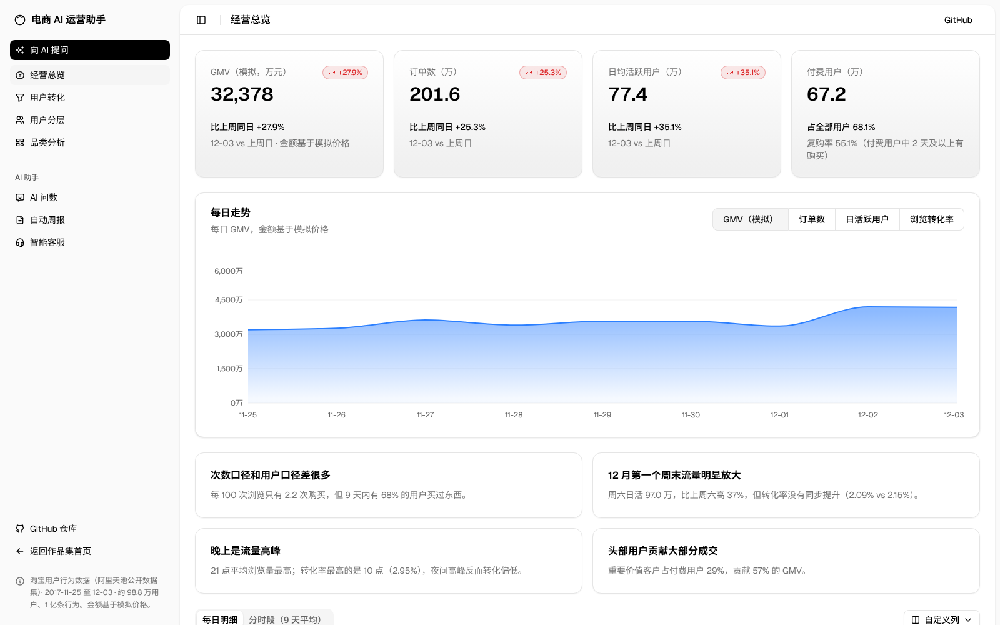

# 电商 AI 运营助手

[在线演示](https://winkless213.github.io/ecom-ai-assistant/)

这个仓库主要改了演示和说明，让项目在手机上也能直接打开，并且数字口径不会看混。

- 经营看板做成了静态站点，不依赖后端。演示地址上可以直接看经营总览、用户转化、用户分层和品类分析。
- 没有后端时，问数、周报、客服不再出现接口报错，而是说明这两类页面需要本地启动 `uvicorn api.web:app --port 8600`。
- 看板上写清了数据口径：数字来自天池全量结果的预计算导出（2017-11-25 至 12-03），金额按可复现的模拟价格计算，原始行为日志里没有成交金额。

问数、周报和客服仍要在本地或自己的服务器上跑接口。静态演示里这三页不能查询。



## 项目做什么

用[阿里天池·淘宝用户购物行为数据](https://tianchi.aliyun.com/dataset/649)做分层数仓（ODS → DWD → DWS → ADS），再用 ADS 支撑四张分析页和三件可以交给模型的工作。全量约 98.8 万用户、1 亿条行为，构建大约 30 秒，并有 16 项质量检查。

问数：中文问题生成只读 SQL，检查通过后执行，失败时最多自动改写两次，再用中文说明结果。只放行单条 `SELECT` / `WITH`，连接只读，并关掉读文件和联网。

周报：指标全部由 SQL 计算，模型只写分析文字；生成后把文中数字和查询结果逐项对照，对不上就标出来。没有密钥或调用失败时退回模板。

客服：按店铺规则文档检索后作答并标明出处，查不到就转人工。默认 BM25，配置向量模型后改为关键词与向量混合检索。另有八类工单分类。

按用户口径，9 天内 61% 的浏览用户完成了购买，但每 100 次浏览大约只有 2.2 次购买。重要价值客户约占付费用户的 28.7%，贡献了 56.9% 的 GMV。问数开发集 23 题准确率 95.7%，另有 10 道未参与调优的题目 10/10（样本不大，只作初步检查）。周报核对在随机改数字 500 次里拦住 88.2%，并在实际模型稿里拦过两处差十倍的金额单位错误。客服检索 Hit@3 和拒答判断在 23 题上都是 100%。完整材料在 `docs/` 和 `reports/`。

客服知识库和工单是虚构的演示数据。

## 本地运行

需要 Python 3.12。只跑现成页面时不必安装 Node；改前端再装 Node 20+。

```bash
python3 -m venv .venv && source .venv/bin/activate
pip install -r requirements.txt
cp .env.example .env                  # 填写 DEEPSEEK_API_KEY；不填也可以看看板，AI 页为演示模式
python pipeline/build_warehouse.py    # 构建数仓并跑质量检查；没有全量 CSV 时可用测试夹具中的样本
uvicorn api.web:app --port 8600       # 打开 http://localhost:8600
```

全量数据需自行从天池下载 `UserBehavior.csv`，放到 `data/raw/`。不下载也可以跑 `pytest`（会自动生成合成数据）。

常用命令：

```bash
pip install -r requirements-dev.txt && pytest
python eval/run_text2sql_eval.py
python eval/run_text2sql_eval.py --holdout
python eval/run_service_eval.py --llm
python eval/run_weekly_guard_demo.py --reuse
cd web && npm ci --legacy-peer-deps && npm run build
```

## 目录

```
├── pipeline/   数仓构建与质量检查
├── sql/        分层建表
├── web/        看板（src/ 为源码，dist/ 为构建结果）
├── api/        FastAPI：web.py 给看板，server.py 给 n8n / Dify
├── ai/         问数、周报、检索和工单分类
├── kb/         客服规则文档和模拟工单
├── eval/       评测集
├── tests/      pytest
├── reports/    质量检查和评测报告
└── docs/       分析说明
```

实现来自 [Lt0226-Win/ecom-ai-assistant](https://github.com/Lt0226-Win/ecom-ai-assistant)。
